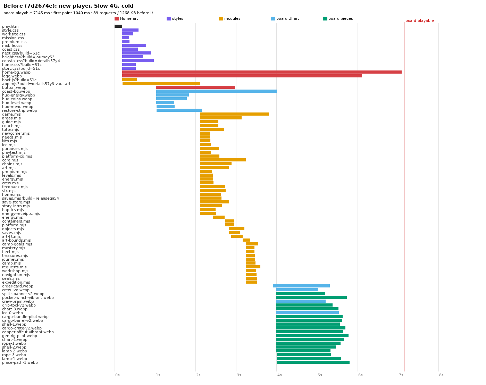
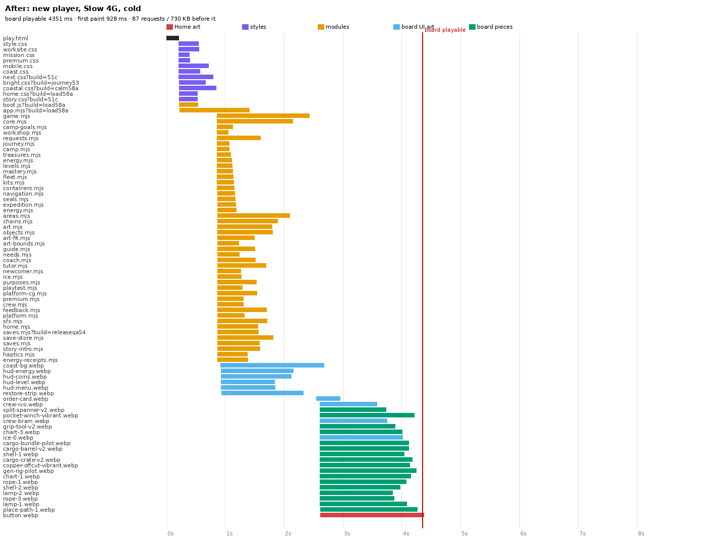
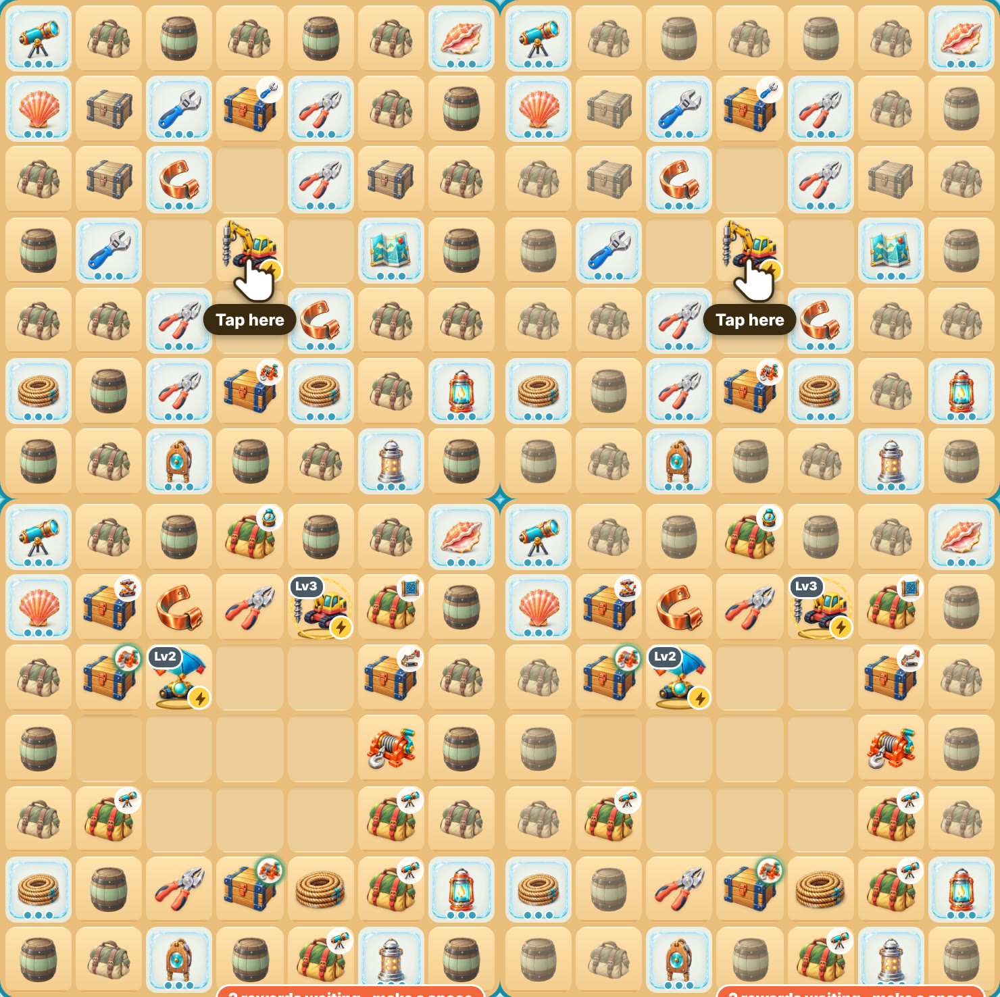

# Vaultwake Merge: loading performance and calmer inactive crates (2026-11-13)

**Status: DRAFT, on `claude/v5-first-session-2-production` (PR #104).** Nothing has been merged, packaged or uploaded.

The owner tested the production preview and reported:
1. the game takes too long to load;
2. inactive crates and barrels are still too colourful.

**Not changed:**
- rules and economy (`v5/next/game.mjs`);
- the board layout, including its 27 crates and 17 tideglass;
- save keys, formats and migrations;
- SDK, Home, Orders, Details, Build and tutorial behaviour.

## 1. How it was measured

| | |
|---|---|
| Server | A local stand-in for Cloudflare Pages: HTTP/2 over TLS, brotli for text, an ETag and Cloudflare's default `public, max-age=0, must-revalidate`, so warm loads revalidate every file. The preview host itself (`*.pages.dev`) is blocked from this sandbox. |
| Phone | Chromium 390×664 at device scale 3, touch. Throttled through the Chrome DevTools Protocol. |
| Slow 4G | 150 ms RTT, 1.6 Mbit/s down, CPU ×4 |
| 4G | 70 ms RTT, 9 Mbit/s down, CPU ×2 |
| CrazyGames | `coast-crazygames.html` opened from a crazygames.com referrer, so the game treats it as a CrazyGames host: it waits for the SDK and reads the cloud. The SDK is a stand-in: 0.4 s to fetch, 0.6 s to initialise, Data module in memory. |
| Players | **New:** nothing stored anywhere. **Returning:** a played camp, in this browser or only in the cloud. |
| Milestones | **First paint.** **Board playable:** the board's 49 cells and all their pictures are in, Home has gone and the guide has its first step; for a returning player, Continue is ready. **First action:** a real tap on the generator until the camp is saved. |
| Runs | The median of 3 runs per row. |
| Baseline | `7d2674e` (frozen copy). |

The measurement scripts are in `docs/evidence/v5-loading-2026-11-13/tools/`.

## 2. The bottleneck (before, new player, Slow 4G)

1. **Home's pictures (580 KB) delayed a new player's board**, although that player never sees Home.
   - The home background (364 KB), logo (175 KB) and button (41 KB) started at 0.2 s and took the bandwidth until 7.1 s.
   - `createHome()` only became usable, and the First Session 2.0 entry only ran, after those three pictures had loaded. The board then came up at 7.15 s.
2. **The game's modules (47 files, 199 KB) arrived in four waves.** Each import level was found only after the previous one had arrived. On a 150 ms network that was four round trips, with the bandwidth shared with Home's pictures (JS done at 3.8 s).
3. **The board's pictures (418 KB, UI and pieces) start only once the game has drawn the board**, so they queue behind both of the above.

The CrazyGames SDK and the cloud read add their own wait (§4). That wait is needed and is kept.

## 3. What changed

| Change | Where | Why it is safe |
|---|---|---|
| **Home's pictures load only when Home will be seen.** If this browser holds a Vaultwake camp (any `vaultwake-v5-coast*` key), they start at once, as before. Otherwise they start when the game asks: Home is shown (returning, damaged save, `?new=1`), or a new player's board is in (for the menu's Home later). | `v5/next/boot.js`, `v5/play.html` (`data-src` instead of `src`), `v5/next/home.mjs` | Only the download order changes. **Who is new is still decided by the game after the save store and the CrazyGames cloud have settled** (`newcomer.mjs`, unchanged). A player whose camp is only in the cloud gets Home with its pictures and Continue, after the cloud is read (tested). |
| **A new player's board no longer waits for Home's pictures** (it still waits for the board's own pictures, so no tile is ever blank). The Play button stays hidden on the way, so its picture is not loaded. | `v5/next/home.mjs` | Returning players are unchanged: Continue still waits for Home's pictures. |
| **Every module is asked for at once.** The page lists the static import graph (`<meta name="vw-modules">`, 45 modules). `boot.js` turns it into `<link rel="modulepreload">` once the styles are in, so first paint is not delayed. | `tools/coast-modules.mjs` (writes and checks the list), `v5/next/boot.js` | The list is generated from the code and checked in CI. A preload is the same address the import uses, so each module is fetched exactly once (tested). A module that fails to load still shows "A game file could not be loaded" with Retry. |
| **While the logo is not asked for, the loading screen names the game in text.** | `v5/next/home.css` | Text only; the logo appears whenever Home is shown. |
| **Cache tags** bumped (`app.mjs`, `boot.js`, `home.css`, `coastal.css`) and the CrazyGames page regenerated. | `v5/play.html`, `v5/coast-crazygames.html` | — |

**Not done, and why:**
- **Re-encoding the approved Home art.** At quality 65–75 it saves only 25–30% (the logo 175 → 124 KB, the background 364 → 270 KB). That would change approved art, which is the owner's call.
- **Removing the CrazyGames SDK wait.** The cloud must be read before deciding new or returning, so this wait stays.

## 4. Before and after

Medians of 3 runs, Chromium 390×664. "Ready" is the board playable for a new player, or Continue for a returning player. Raw medians: `docs/evidence/v5-loading-2026-11-13/results-*.txt`.

| Scenario | Ready: before → after | First paint: before → after | KB before ready: before → after |
|---|---|---|---|
| **New player, preview page, Slow 4G, cold** | **7.27 s → 4.41 s (−39%)** | 1.04 → 0.92 s | 1268 → 730 |
| New player, CrazyGames page, Slow 4G, cold | 7.29 s → 5.76 s (−21%) | 1.05 → 0.94 s | 1269 → 789 |
| New player, preview page, 4G, cold | 1.44 s → 1.11 s (−23%) | 0.33 → 0.35 s | 1268 → 730 |
| New player, CrazyGames page, 4G, cold | 2.06 s → 1.81 s (−12%) | 0.33 → 0.32 s | 1409 → 789 |
| Returning (camp in this browser), preview, Slow 4G, cold | 7.36 s → 7.14 s (−3%) | 1.03 → 0.94 s | 1268 → 1269 |
| Returning, CrazyGames page, Slow 4G, cold | 7.13 s → 7.33 s (+3%, noise; the same bytes) | 1.05 → 0.94 s | 1269 → 1270 |
| Returning, preview, Slow 4G, **warm** (every file revalidated) | 1.41 s → 1.15 s (−18%) | 0.50 → 0.46 s | 5 → 5 |

**Other measurements:**
- **First action** (a real tap on the generator until the camp is saved): 0.17–0.24 s before and after, on every profile. The board takes input as soon as it is shown.
- **The bottleneck is gone from the waterfall.** No Home picture before the board. The modules come in one wave (done by 2.4 s instead of 3.8 s). The board's pictures follow at once.

**Trade-off: reloading in the first seconds.** A new player who reloads within a few seconds of their first board, on Slow 4G, gets Home before its pictures have finished loading in the background. In the test that was 3.9 s, against 1.3 s before, because the 580 KB were not cached yet. From the second visit on, the pictures are cached: they load 1.5 s after the first board.

**CrazyGames numbers:** these rows were taken after the Play-button fix. The preview-page rows were taken just before it; that fix does not touch the preview path, where the button was never shown.

## 5. Calmer inactive crates (P1)

Inactive crates are those the rules say the player cannot work on yet (`later`: buried, or their generator is not here). They now recede into a soft warm neutral:

| | Before | After |
|---|---|---|
| Filter | `saturate(.5) sepia(.22) brightness(1.03) contrast(.9)` | `saturate(.3) sepia(.3) brightness(1.05) contrast(.78)` |
| Opacity | .86 | .70 |
| Size | 88% | 86% |
| Glow or motion | none | none |

**Only `.cargo.later` changes.** Unchanged:
- generators and items;
- reachable crates (the key shows);
- crates whose key is on the board (green ring);
- tideglass, with its crack pips.

A later crate that is selected, matched or a guide target is shown in full colour. The state classes come from the game's rules (`reachable()`, `sourceOpen()`), as in Stage B. `tests/v5-next-board-feedback-browser.cjs` checks each crate's class against the rules.

Board, before (left) → after (right), at 360, 390 and 430 px. Top: a new player's board. Bottom: the chapter-1 fixture camp. See `docs/evidence/v5-loading-2026-11-13/board-compare-*.jpg`.

## 6. Tests

| Test | Covers |
|---|---|
| `tests/v5-next-modules.test.mjs` (unit) | The page's module list equals the import graph, in both pages. No Home picture loads by itself. Preloads come from `boot.js`. |
| `tests/v5-next-load-browser.cjs` (Chromium + WebKit) | Every module preloaded once and fetched once. A new player's board without Home's pictures, then a first tap that saves. The text title while the logo is not asked for. A camp only in the CrazyGames cloud: Continue, with Home's pictures, cloud camp kept. A camp in this browser: Home's pictures at once. |
| `tests/v5-next-home-browser.cjs` | Scenario 1: a new player's board never asks for Home's pictures; they load afterwards. New scenario 1b: a returning player sees the real "1 of 3 pictures" count and Continue. |
| CI `.github/workflows/v5-first-session-2.yml` | All of the above plus every Coast Camp suite, in Chromium and WebKit. The unit job also runs `node tools/coast-modules.mjs --check`. |

## 7. Known limits

- **Returning players on Slow 4G are still bandwidth-bound.** Continue waits for Home's 580 KB of approved art plus the modules. On 4G and warm loads the round trips saved by the preloads help more. To go further, one of these needs the owner's approval:
  - (a) lighter Home art;
  - (b) Continue usable before the background has finished loading.
- **CrazyGames, a returning guest whose camp is only in the cloud:** this browser holds no camp, so Home's pictures start after the cloud has been read, not at once. Their Home appears a little later than before on slow networks; their camp is never at risk.
- **The real CrazyGames SDK's fetch and initialisation times are not known here.** The stand-in uses 0.4 s and 0.6 s.
- **Cloudflare's real HTTP/2 prioritisation may differ from the stand-in's,** which does not prioritise. A real-device check on the preview is still needed.
